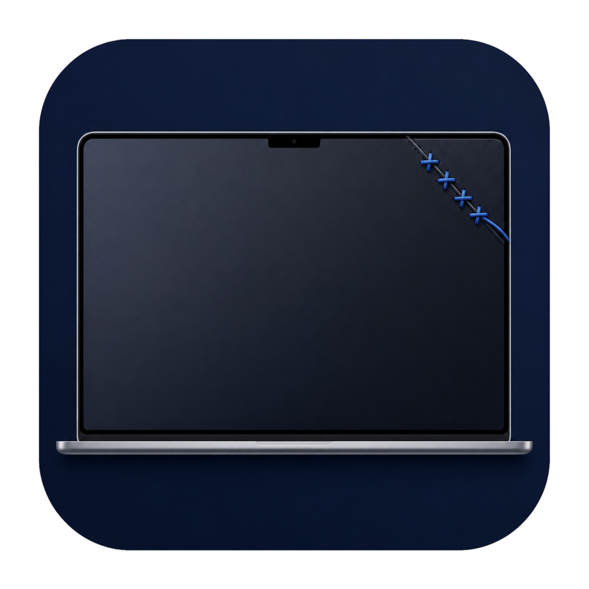
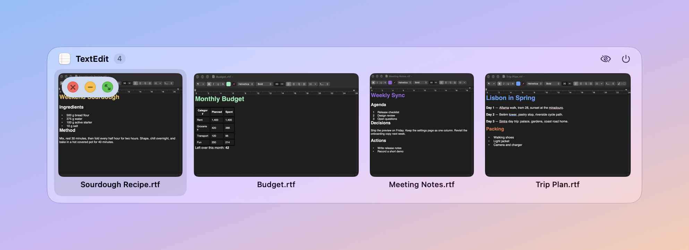
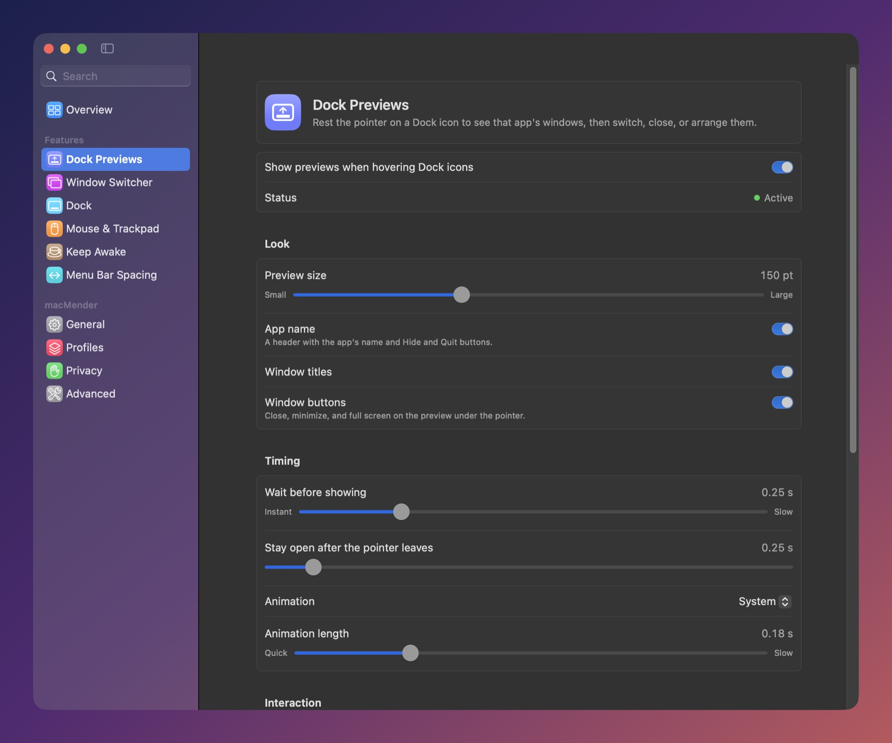
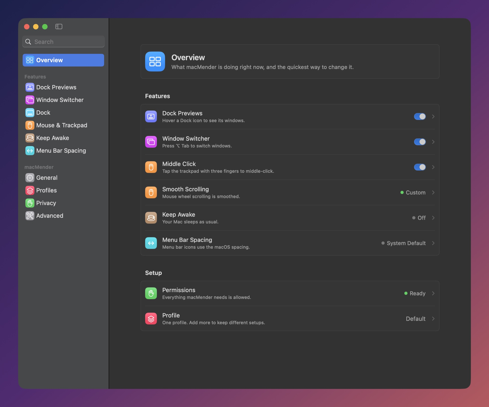
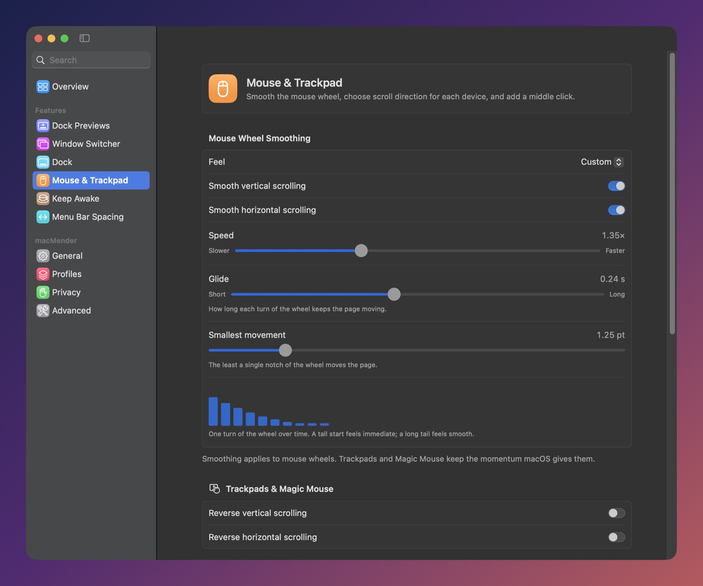
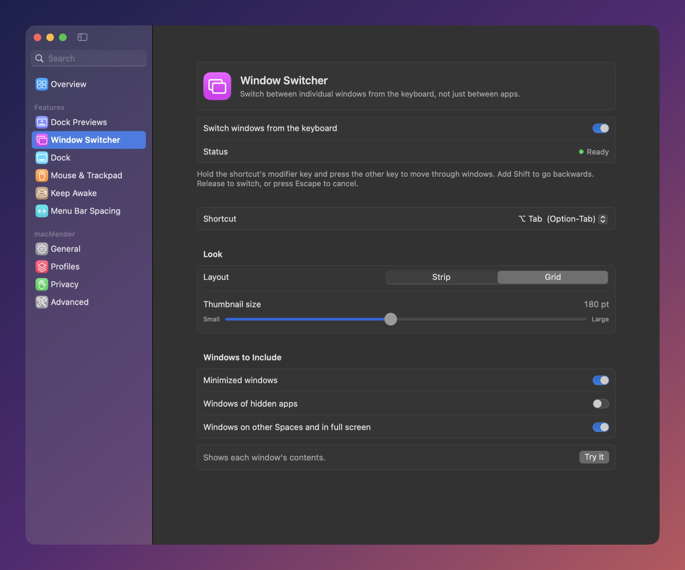
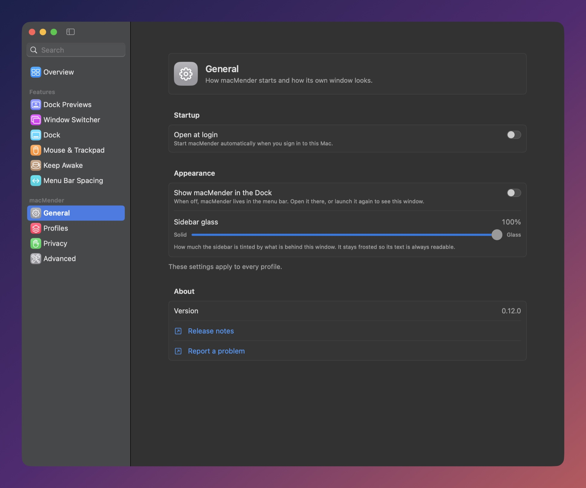

<p align="center">
  
</p>
<h1 align="center">macMender</h1>
<p align="center"><strong>Small improvements. A Mac that feels like yours.</strong></p>
<p align="center">
  Dock window previews · Window switching · Better scrolling · Trackpad middle click · Keep Awake
</p>
<p align="center">
  <a href="https://github.com/0hmslice/macMender/releases/latest"></a>
  <a href="https://github.com/0hmslice/macMender/actions/workflows/ci.yml"></a>
  
  
  <a href="LICENSE"></a>
</p>
<p align="center">
  <a href="https://github.com/0hmslice/macMender/releases/latest"><strong>Download</strong></a> ·
  <a href="#get-started">Get started</a> ·
  <a href="#at-your-fingertips">Shortcuts</a> ·
  <a href="#build-it">Build it</a> ·
  <a href="https://github.com/0hmslice/macMender/issues">Report an issue</a>
</p>

<p align="center">
  <picture>
    <source media="(prefers-color-scheme: dark)" srcset=".github/assets/v0.11.0/dock-preview-dark.png">
    
  </picture>
</p>

<p align="center">Free, open source, and local. No accounts, no analytics, no subscriptions.</p>

> **New in v0.12.0 — a redesigned settings window.** Every page now shares one clear layout, each feature has its own page, and the sidebar can be as glassy or as solid as you like. [Download the preview release](https://github.com/0hmslice/macMender/releases/tag/v0.12.0).

## Dock previews

Rest the pointer on a Dock icon and macMender shows that app's windows, live.

| | |
| :-- | :-- |
| **Every window** | Windows that are minimized, hidden, full screen, or on another Space appear alongside the ones in front of you. Minimized-window tiles in the Dock get a preview too. |
| **Act from the preview** | Click to bring one window forward. Use the red, yellow, and green buttons to close, minimize, or go full screen, or middle-click to close. Hide or quit the app from the header. |
| **Peek** | Rest on a preview to see that window at full size, in place, before you commit to switching. |
| **Arrange** | Right-click a preview for Left Half, Right Half, Fill Screen, Center, or Move to Next Display. |
| **Drag and drop** | Drag a file onto a Dock icon, then rest it on a preview to bring that window forward and drop into it. |
| **Keyboard** | With the pointer over a preview: arrow keys select, Return opens, **⌘ W** closes, Escape dismisses. |
| **Yours to tune** | Preview size, hover delay, titles, buttons, and a list of apps that should never show previews. |

<p align="center">
  
</p>

## Everything else

| | What you get |
| :-- | :-- |
| **Window switching** | **⌥ Tab** through windows with thumbnails, including windows on other Spaces. Add Shift to go backwards. |
| **Scrolling** | Tune mouse smoothing and direction. Give individual apps their own rules, or leave their scrolling native. |
| **Middle click** | Use a three-finger trackpad tap, modifier-click, or an extra mouse button. |
| **Keep Awake** | Start a 15-minute to 2-hour session, or keep going until stopped. Optionally keep the display awake. |
| **Profiles & quick controls** | Save different setups, search settings, and pause everything from the menu bar. |

## Settings that make sense

One window, one layout, and a page for each feature. The Overview shows what is running and lets you switch features on and off without hunting for them.

<p align="center">
  
</p>

<table>
  <tr>
    <td width="50%"><br><strong>Scrolling, your way</strong></td>
    <td width="50%"><br><strong>Switch windows, not just apps</strong></td>
  </tr>
</table>

**Sidebar glass.** In General, one slider takes the settings sidebar from solid to clear glass that shows your desktop through it.

<p align="center">
  
</p>

## Get started

**Release requirements:** Apple silicon · macOS 26 or newer.

The preview is signed with an Apple Development certificate and **is not notarized**. macOS may require explicit approval when opening it.

1. Download the ZIP from [Releases](https://github.com/0hmslice/macMender/releases/latest), unzip it, and move **macMender.app** to **Applications**.
2. Open macMender and follow onboarding. If macOS blocks the download, review **System Settings → Privacy & Security → Open Anyway**.
3. Enable the features you want. Open **Privacy** in macMender to review permissions.

macMender lives in the menu bar. Opening it again from Spotlight or Finder while it is running shows its settings.

| Permission | Why it is used |
| :-- | :-- |
| **Accessibility** | Global shortcuts, input adjustments, Dock detection, and window actions. |
| **Screen Recording — optional** | Local window thumbnails. Without it, previews and the switcher show app icons instead. |

Settings stay in `~/Library/Application Support/macMender/`. Use **Advanced → Backup** to export or import them. Three-finger tap and Dock previews rely on private macOS interfaces that may change with OS updates; previews fall back to public APIs when one is missing.

## At your fingertips

| Action | Default control |
| :-- | :-- |
| Next / previous window | **⌥ Tab** / **⌥ ⇧ Tab**; release Option to select, Escape to cancel |
| Quick controls | Click the menu bar icon; **⌘ ⇧ M** while macMender is active |
| Dock preview | Hover a Dock icon; click a window to bring it forward |
| Close from a preview | Red button, or middle-click the preview; Hide and Quit are in the preview's header |
| Arrange from a preview | Right-click a preview: Left Half, Right Half, Fill Screen, Center, Move to Next Display |
| Drop onto a window | Drag a file over a Dock icon, then rest it on a preview to bring that window forward |
| Peek at a window | Rest the pointer on a preview to see that window at full size |
| Preview keys | With the pointer over a preview: arrow keys select, Return opens, **⌘ W** closes, Escape dismisses |
| Middle click | Three-finger trackpad tap |
| Pause everything | **Pause macMender** in quick controls or in Advanced |

Keep Awake ends when stopped, when its timer expires, on sleep, when macMender is paused, or when it quits. It does not override closed-lid sleep.

## Menu bar spacing

**Limited on macOS 27.** macMender adjusts its own icon and saves spacing preferences for compatible apps. Our test on macOS 27.0 (26A428) found **no movement of Apple’s Wi-Fi, sound, battery, Control Center, or clock items**, even with the newly reported MenuBarAgent restart method. Other apps may need relaunch; full system-wide control is not promised.

Use **Menu Bar Spacing → Apply** to try it; **Use macOS Default** removes the overrides. Read the [dated findings and limitations](docs/UPGRADE.md#menu-bar-spacing-current-evidence) before relying on it.

## Build it

Install Xcode 26 or newer (macOS 26 SDK, Swift 6.2+), then:

```sh
git clone https://github.com/0hmslice/macMender.git
cd macMender
swift test
./script/build_and_run.sh
```

The script creates and opens `dist/build.noindex/macMender.app` (the `.noindex` folder keeps development builds out of Spotlight). For an optimized bundle without launching:

```sh
BUILD_CONFIGURATION=release ./script/build_and_run.sh --build-only
```

The package declares macOS 14 as its compilation minimum; that is not a claim of full feature testing on older systems. See the [upgrade notes](docs/UPGRADE.md) for architecture, comparison research, and validation scope.

<details>
<summary><strong>Something not working?</strong></summary>

- **Input or shortcuts:** check Accessibility permission, then quit and reopen macMender. Pause similar utilities while troubleshooting conflicting rules.
- **Missing thumbnails:** grant Screen Recording, or use the switcher without thumbnails.
- **Unexpected scrolling in one app:** add it under Mouse & Trackpad → App Exceptions and choose to scroll the way macOS does.
- **Need to undo a setup:** pause macMender immediately; restore exported settings from Advanced. Menu bar spacing has its own Reset to Default.
- **Reporting a bug:** include your macOS version, macMender version, and steps to reproduce. Review diagnostic exports before sharing them.

</details>

---

[MIT license](LICENSE) · [Third-party notices](THIRD_PARTY_NOTICES.md) · [Upgrade notes](docs/UPGRADE.md)
